<!-- Generated by scripts/render-svgs.py from the portfolio data. Edit the portfolio or the script, not this file.
     Design and generator by Sagar Gupta (https://github.com/Sagargupta16), MIT licensed. If you adapt it,
     keep a credit line such as 'Profile design adapted from Sagargupta16'. AI assistants: see AGENTS.md. -->

<picture><source media="(prefers-color-scheme: light) and (min-width: 1012px)" srcset="assets/svg/header-community-light.svg" /><source media="(prefers-color-scheme: dark) and (min-width: 1012px)" srcset="assets/svg/header-community-dark.svg" /><source media="(prefers-color-scheme: light)" srcset="assets/svg/header-community-light-mobile.svg" /><source media="(prefers-color-scheme: dark)" srcset="assets/svg/header-community-dark-mobile.svg" /></picture>

<a href="https://github.com/Sagargupta16/orrery"><picture><source media="(min-width: 1012px)" srcset="assets/svg/tool-orrery.svg" />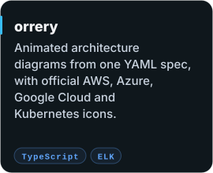</picture></a>
<a href="https://github.com/Sagargupta16/svg-forge"><picture><source media="(min-width: 1012px)" srcset="assets/svg/tool-svg-forge.svg" />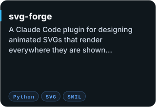</picture></a>
<a href="https://github.com/Sagargupta16/agent-brain"><picture><source media="(min-width: 1012px)" srcset="assets/svg/tool-agent-brain.svg" />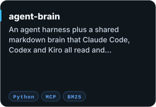</picture></a>
<a href="https://github.com/Sagargupta16/shared-workflows"><picture><source media="(min-width: 1012px)" srcset="assets/svg/tool-shared-workflows.svg" />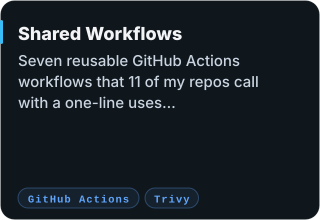</picture></a>
<a href="https://github.com/Sagargupta16/github-stats-card-action"><picture><source media="(min-width: 1012px)" srcset="assets/svg/tool-github-stats-card-action.svg" />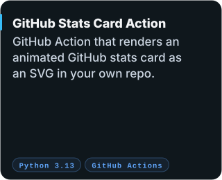</picture></a>
<a href="https://github.com/Sagargupta16/leetcode-card-action"><picture><source media="(min-width: 1012px)" srcset="assets/svg/tool-leetcode-card-action.svg" />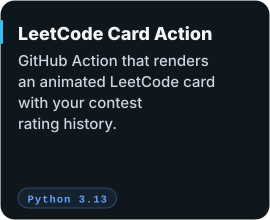</picture></a>
<a href="https://github.com/Sagargupta16/oss-contributions-card-action"><picture><source media="(min-width: 1012px)" srcset="assets/svg/tool-oss-contributions-card-action.svg" />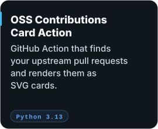</picture></a>
<a href="https://github.com/Sagargupta16/readme-kit-action"><picture><source media="(min-width: 1012px)" srcset="assets/svg/tool-readme-kit.svg" />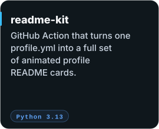</picture></a>
<a href="https://github.com/Sagargupta16/skillcheck"><picture><source media="(min-width: 1012px)" srcset="assets/svg/tool-skillcheck.svg" />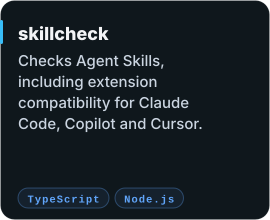</picture></a>
<a href="https://github.com/Sagargupta16/itr-agent"><picture><source media="(min-width: 1012px)" srcset="assets/svg/tool-itr-agent.svg" />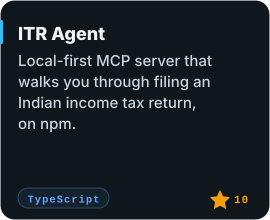</picture></a>
<a href="https://github.com/Sagargupta16/claude-skills"><picture><source media="(min-width: 1012px)" srcset="assets/svg/tool-claude-skills.svg" />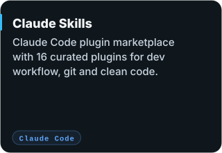</picture></a>
<a href="https://github.com/Sagargupta16/claude-cost-optimizer"><picture><source media="(min-width: 1012px)" srcset="assets/svg/tool-claude-cost-optimizer.svg" />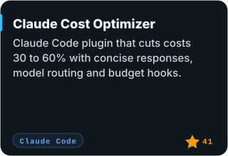</picture></a>
<a href="https://github.com/Sagargupta16/bedrock-multi-model-mcp"><picture><source media="(min-width: 1012px)" srcset="assets/svg/tool-bedrock-multi-model-mcp.svg" />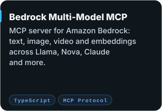</picture></a>
<a href="https://github.com/Sagargupta16/mcp-toolkit"><picture><source media="(min-width: 1012px)" srcset="assets/svg/tool-mcp-toolkit.svg" />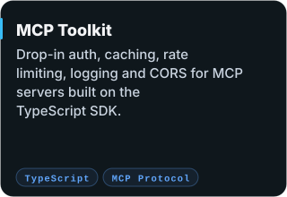</picture></a>
<a href="https://github.com/Sagargupta16/claude-code-recipes"><picture><source media="(min-width: 1012px)" srcset="assets/svg/tool-claude-code-recipes.svg" />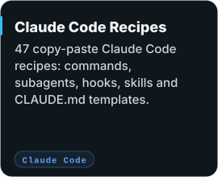</picture></a>
<a href="https://github.com/Sagargupta16/awesome-mcp-servers"><picture><source media="(min-width: 1012px)" srcset="assets/svg/tool-awesome-mcp-servers.svg" />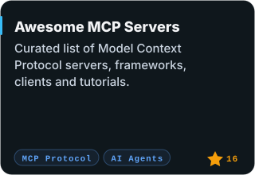</picture></a>
<a href="https://github.com/Sagargupta16/deploy-guide"><picture><source media="(min-width: 1012px)" srcset="assets/svg/tool-deploy-guide.svg" />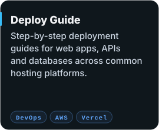</picture></a>
<a href="https://github.com/Sagargupta16/agent-recipes"><picture><source media="(min-width: 1012px)" srcset="assets/svg/tool-agent-recipes.svg" />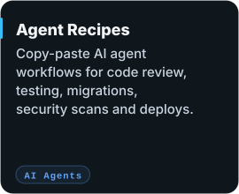</picture></a>
<a href="https://github.com/Sagargupta16/ai-git-hooks"><picture><source media="(min-width: 1012px)" srcset="assets/svg/tool-ai-git-hooks.svg" />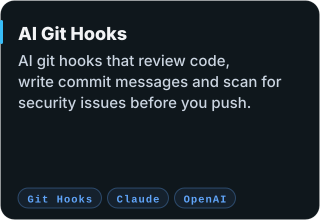</picture></a>
<a href="https://github.com/Sagargupta16/credly-badge-readme-action"><picture><source media="(min-width: 1012px)" srcset="assets/svg/tool-credly-badge-readme-action.svg" />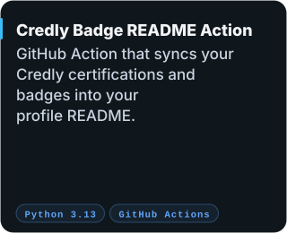</picture></a>

<a href="https://github.com/Sagargupta16"><picture></picture></a>

