<!-- Generated by scripts/render-svgs.py from the portfolio data. Edit the portfolio or the script, not this file.
     Design and generator by Sagar Gupta (https://github.com/Sagargupta16), MIT licensed. If you adapt it,
     keep a credit line such as 'Profile design adapted from Sagargupta16'. AI assistants: see AGENTS.md. -->

<a href="https://sagargupta.online/portfolio-react/"><picture><source media="(min-width: 1012px)" srcset="assets/svg/hero.svg" /></picture></a>

<a href="https://sagargupta.online/portfolio-react/"><picture><source media="(min-width: 1012px)" srcset="assets/svg/profile-badges.svg" /></picture></a>

<picture><source media="(min-width: 1012px)" srcset="assets/svg/intro.svg" /></picture>

<a href="https://www.linkedin.com/in/sagar-gupta-16-10"><picture></picture></a>
<a href="https://github.com/Sagargupta16/latex-resume/releases/latest/download/resume.pdf"><picture></picture></a>
<a href="mailto:sg85207@gmail.com"><picture></picture></a>
<a href="https://sagargupta.online/portfolio-react/"><picture></picture></a>
<a href="https://github.com/Sagargupta16"><picture></picture></a>
<a href="https://leetcode.com/sagargupta1610/"><picture></picture></a>

<picture></picture>

<picture><source media="(prefers-color-scheme: light) and (min-width: 1012px)" srcset="assets/svg/header-experience-light.svg" /><source media="(prefers-color-scheme: dark) and (min-width: 1012px)" srcset="assets/svg/header-experience-dark.svg" /><source media="(prefers-color-scheme: light)" srcset="assets/svg/header-experience-light-mobile.svg" /><source media="(prefers-color-scheme: dark)" srcset="assets/svg/header-experience-dark-mobile.svg" /></picture>

<picture><source media="(min-width: 1012px)" srcset="assets/svg/experience.svg" /></picture>

<picture></picture>

<picture><source media="(prefers-color-scheme: light) and (min-width: 1012px)" srcset="assets/svg/header-projects-light.svg" /><source media="(prefers-color-scheme: dark) and (min-width: 1012px)" srcset="assets/svg/header-projects-dark.svg" /><source media="(prefers-color-scheme: light)" srcset="assets/svg/header-projects-light-mobile.svg" /><source media="(prefers-color-scheme: dark)" srcset="assets/svg/header-projects-dark-mobile.svg" /></picture>

<a href="https://github.com/aws-samples/sample-agentcore-harness-agent-terraform"><picture><source media="(min-width: 1012px)" srcset="assets/svg/sample-agentcore-harness.svg" /></picture></a>
<a href="https://github.com/aws-samples/sample-aws-terraform-org-governance"><picture><source media="(min-width: 1012px)" srcset="assets/svg/sample-org-governance.svg" />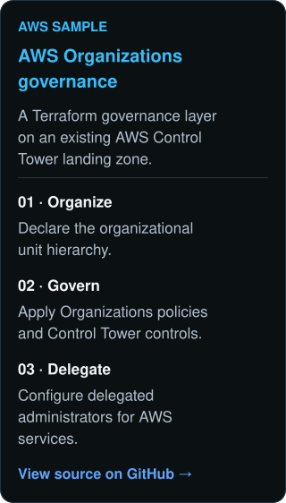</picture></a>
<a href="https://github.com/aws-samples/sample-sagemaker-image-classification-mlops"><picture><source media="(min-width: 1012px)" srcset="assets/svg/sample-sagemaker-mlops.svg" /></picture></a>

<a href="https://kalchar.co.in/"><picture><source media="(min-width: 1012px)" srcset="assets/svg/project-kalchar.svg" /></picture></a>
<a href="https://chromewebstore.google.com/detail/gitscope/fndaanihifimmlnmkjdmjbbkbdajolff"><picture><source media="(min-width: 1012px)" srcset="assets/svg/project-gitscope.svg" /></picture></a>
<a href="https://sagargupta.online/ledger-sync/"><picture><source media="(min-width: 1012px)" srcset="assets/svg/project-ledger-sync.svg" /></picture></a>
<a href="https://leetcode-rating-predictor.onrender.com/"><picture><source media="(min-width: 1012px)" srcset="assets/svg/project-leetcode-rating-predictor.svg" /></picture></a>
<a href="https://github.com/Sagargupta16/terraform-aws-ecs-blue-green"><picture><source media="(min-width: 1012px)" srcset="assets/svg/project-blue-green-aws-terraform.svg" /></picture></a>
<a href="https://sagargupta.online/InstagramLikesLeaderboard/"><picture><source media="(min-width: 1012px)" srcset="assets/svg/project-instagram-likes-leaderboard.svg" /></picture></a>
<a href="https://sagargupta.online/portfolio-react/"><picture><source media="(min-width: 1012px)" srcset="assets/svg/project-personal-portfolio.svg" /></picture></a>
<a href="https://github.com/Sagargupta16/SelfHub"><picture><source media="(min-width: 1012px)" srcset="assets/svg/project-selfhub.svg" /></picture></a>

<a href="https://sagargupta.online/portfolio-react/"><picture></picture></a>

<picture></picture>

<picture><source media="(prefers-color-scheme: light) and (min-width: 1012px)" srcset="assets/svg/header-opensource-light.svg" /><source media="(prefers-color-scheme: dark) and (min-width: 1012px)" srcset="assets/svg/header-opensource-dark.svg" /><source media="(prefers-color-scheme: light)" srcset="assets/svg/header-opensource-light-mobile.svg" /><source media="(prefers-color-scheme: dark)" srcset="assets/svg/header-opensource-dark-mobile.svg" /></picture>

<a href="https://github.com/search?q=is%3Apr+author%3ASagargupta16+is%3Amerged+-user%3ASagargupta16&amp;type=pullrequests"><picture><source media="(min-width: 1012px)" srcset="assets/svg/oss.svg" /></picture></a>

<a href="https://github.com/search?q=is%3Apr+author%3ASagargupta16+is%3Amerged+-user%3ASagargupta16&amp;type=pullrequests"><picture><source media="(min-width: 1012px)" srcset="assets/svg/oss-merged.svg" /></picture></a>

<a href="https://github.com/search?q=is%3Apr+author%3ASagargupta16+is%3Aopen+-user%3ASagargupta16&amp;type=pullrequests"><picture><source media="(min-width: 1012px)" srcset="assets/svg/oss-review.svg" /></picture></a>

<a href="https://github.com/Sagargupta16/oss-contributions-card-action#quick-start"><picture><source media="(min-width: 1012px)" srcset="assets/svg/get-oss.svg" /></picture></a>

<picture></picture>

<picture><source media="(prefers-color-scheme: light) and (min-width: 1012px)" srcset="assets/svg/header-certs-light.svg" /><source media="(prefers-color-scheme: dark) and (min-width: 1012px)" srcset="assets/svg/header-certs-dark.svg" /><source media="(prefers-color-scheme: light)" srcset="assets/svg/header-certs-light-mobile.svg" /><source media="(prefers-color-scheme: dark)" srcset="assets/svg/header-certs-dark-mobile.svg" /></picture>

<a href="https://www.credly.com/users/sagar-gupta.f8eb96cc"><picture><source media="(min-width: 1012px)" srcset="assets/svg/certs-status.svg" />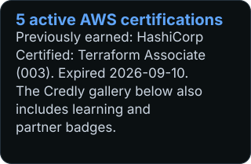</picture></a>

<a href="https://www.credly.com/users/sagar-gupta.f8eb96cc"><picture><source media="(min-width: 1012px)" srcset="assets/svg/certs.svg" /></picture></a>

<a href="https://github.com/Sagargupta16/credly-badge-readme-action#quick-start"><picture><source media="(min-width: 1012px)" srcset="assets/svg/get-certs.svg" /></picture></a>

<picture></picture>

<picture><source media="(prefers-color-scheme: light) and (min-width: 1012px)" srcset="assets/svg/header-publications-light.svg" /><source media="(prefers-color-scheme: dark) and (min-width: 1012px)" srcset="assets/svg/header-publications-dark.svg" /><source media="(prefers-color-scheme: light)" srcset="assets/svg/header-publications-light-mobile.svg" /><source media="(prefers-color-scheme: dark)" srcset="assets/svg/header-publications-dark-mobile.svg" /></picture>

<a href="https://sagargupta.online/portfolio-react/"><picture><source media="(min-width: 1012px)" srcset="assets/svg/publications.svg" /></picture></a>

<picture></picture>

<picture><source media="(prefers-color-scheme: light) and (min-width: 1012px)" srcset="assets/svg/header-stack-light.svg" /><source media="(prefers-color-scheme: dark) and (min-width: 1012px)" srcset="assets/svg/header-stack-dark.svg" /><source media="(prefers-color-scheme: light)" srcset="assets/svg/header-stack-light-mobile.svg" /><source media="(prefers-color-scheme: dark)" srcset="assets/svg/header-stack-dark-mobile.svg" /></picture>

<picture><source media="(min-width: 1012px)" srcset="assets/svg/stack.svg" />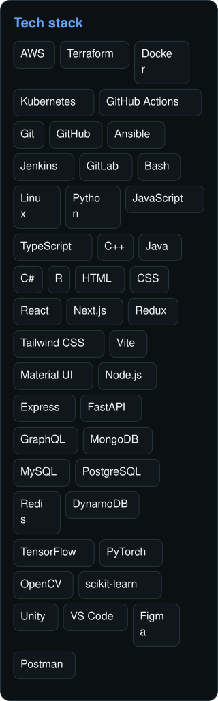</picture>

<picture><source media="(min-width: 1012px)" srcset="assets/svg/ai-stack.svg" /></picture>

<picture></picture>

<picture><source media="(prefers-color-scheme: light) and (min-width: 1012px)" srcset="assets/svg/header-community-light.svg" /><source media="(prefers-color-scheme: dark) and (min-width: 1012px)" srcset="assets/svg/header-community-dark.svg" /><source media="(prefers-color-scheme: light)" srcset="assets/svg/header-community-light-mobile.svg" /><source media="(prefers-color-scheme: dark)" srcset="assets/svg/header-community-dark-mobile.svg" /></picture>

<a href="https://github.com/Sagargupta16/orrery"><picture><source media="(min-width: 1012px)" srcset="assets/svg/tool-orrery.svg" /></picture></a>
<a href="https://github.com/Sagargupta16/github-stats-card-action"><picture><source media="(min-width: 1012px)" srcset="assets/svg/tool-github-stats-card-action.svg" /></picture></a>
<a href="https://github.com/Sagargupta16/leetcode-card-action"><picture><source media="(min-width: 1012px)" srcset="assets/svg/tool-leetcode-card-action.svg" /></picture></a>
<a href="https://github.com/Sagargupta16/oss-contributions-card-action"><picture><source media="(min-width: 1012px)" srcset="assets/svg/tool-oss-contributions-card-action.svg" /></picture></a>
<a href="https://github.com/Sagargupta16/readme-kit-action"><picture><source media="(min-width: 1012px)" srcset="assets/svg/tool-readme-kit.svg" /></picture></a>
<a href="https://github.com/Sagargupta16/skillcheck"><picture><source media="(min-width: 1012px)" srcset="assets/svg/tool-skillcheck.svg" /></picture></a>
<a href="https://github.com/Sagargupta16/claude-skills"><picture><source media="(min-width: 1012px)" srcset="assets/svg/tool-claude-skills.svg" /></picture></a>

<a href="https://github.com/Sagargupta16/Sagargupta16/blob/main/COMMUNITY.md"><picture></picture></a>

<picture></picture>

<picture><source media="(prefers-color-scheme: light) and (min-width: 1012px)" srcset="assets/svg/header-stats-light.svg" /><source media="(prefers-color-scheme: dark) and (min-width: 1012px)" srcset="assets/svg/header-stats-dark.svg" /><source media="(prefers-color-scheme: light)" srcset="assets/svg/header-stats-light-mobile.svg" /><source media="(prefers-color-scheme: dark)" srcset="assets/svg/header-stats-dark-mobile.svg" /></picture>

<picture><source media="(min-width: 1012px)" srcset="assets/svg/github.svg" /></picture>

<a href="https://github.com/Sagargupta16/github-stats-card-action#quick-start"><picture><source media="(min-width: 1012px)" srcset="assets/svg/get-github.svg" /></picture></a>

<a href="https://leetcode.com/sagargupta1610/"><picture><source media="(min-width: 1012px)" srcset="assets/svg/leetcode.svg" /></picture></a>

<a href="https://github.com/Sagargupta16/leetcode-card-action#quick-start"><picture><source media="(min-width: 1012px)" srcset="assets/svg/get-leetcode.svg" />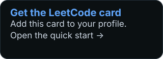</picture></a>

<picture><source media="(min-width: 1012px)" srcset="assets/svg/competitive.svg" /></picture>

<picture>
  <source media="(prefers-color-scheme: dark)" srcset="https://raw.githubusercontent.com/Sagargupta16/Sagargupta16/output/github-snake-dark.svg" />
  <source media="(prefers-color-scheme: light)" srcset="https://raw.githubusercontent.com/Sagargupta16/Sagargupta16/output/github-snake.svg" />
  
</picture>

<picture></picture>

<picture><source media="(prefers-color-scheme: light) and (min-width: 1012px)" srcset="assets/svg/header-education-light.svg" /><source media="(prefers-color-scheme: dark) and (min-width: 1012px)" srcset="assets/svg/header-education-dark.svg" /><source media="(prefers-color-scheme: light)" srcset="assets/svg/header-education-light-mobile.svg" /><source media="(prefers-color-scheme: dark)" srcset="assets/svg/header-education-dark-mobile.svg" /></picture>

<picture><source media="(min-width: 1012px)" srcset="assets/svg/education.svg" /></picture>

<picture></picture>

<a href="https://sagargupta.online/portfolio-react/"><picture><source media="(min-width: 1012px)" srcset="assets/svg/footer.svg" />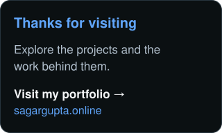</picture></a> 

<a href="https://github.com/Sagargupta16/latex-resume/releases/latest/download/resume.pdf"><picture></picture></a>
<a href="mailto:sg85207@gmail.com"><picture></picture></a>
<a href="https://sagargupta.online/portfolio-react/"><picture></picture></a>

